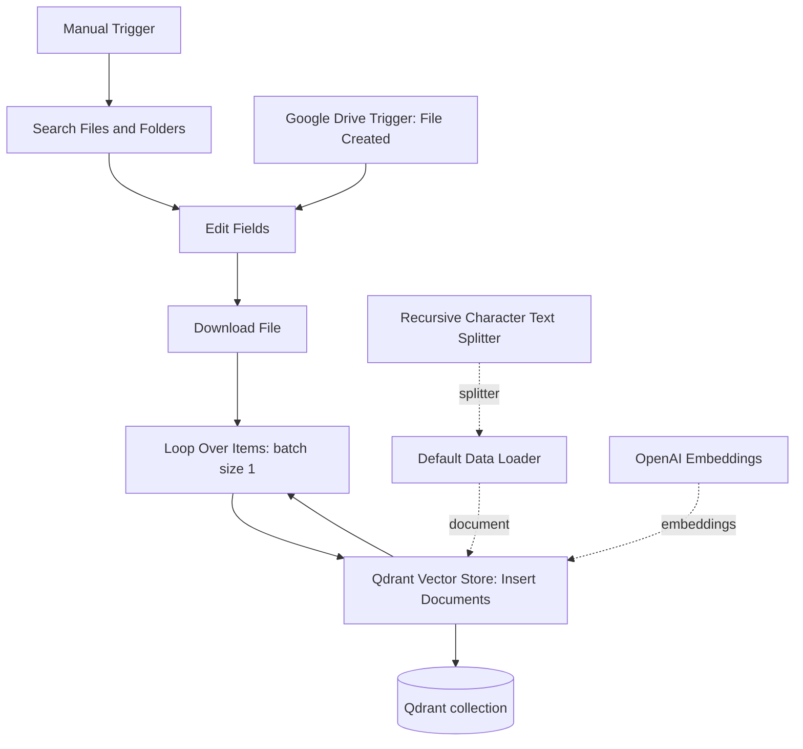
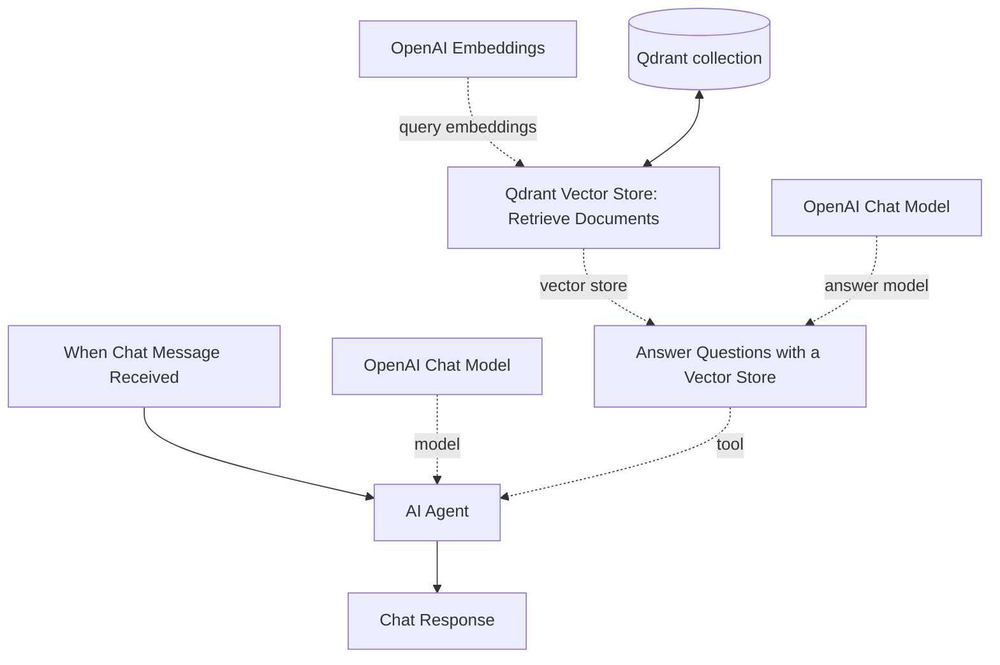
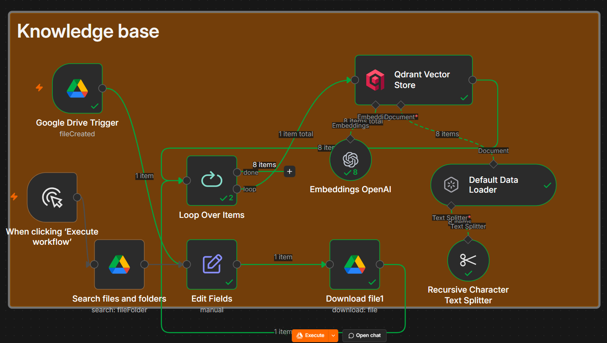
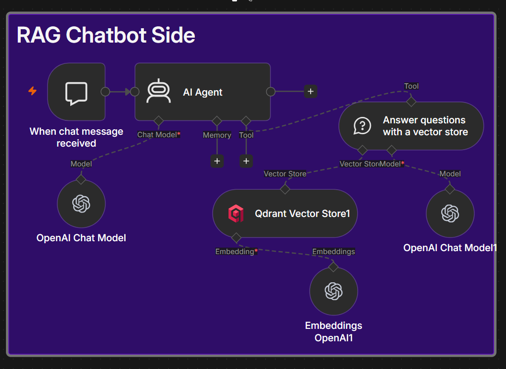
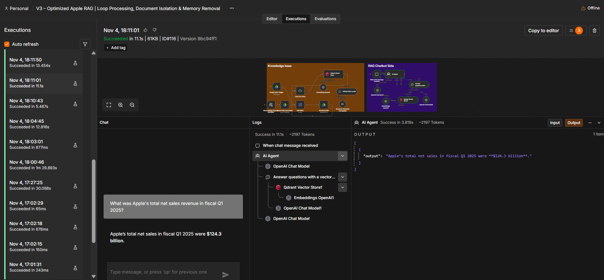
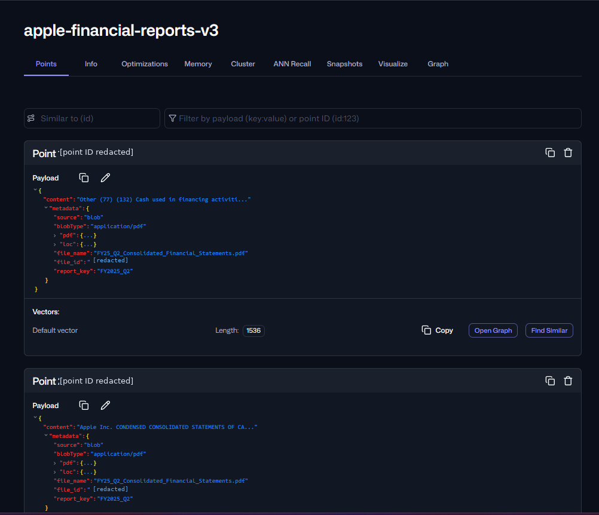

# Apple Financial RAG Agent

**An end-to-end, document-grounded financial research assistant built with n8n, OpenAI, Google Drive, and Qdrant.**

This project automates the ingestion of Apple Inc.'s quarterly financial statements and makes their contents searchable through a conversational AI agent. It supports both initial ingestion of existing reports and monitoring for newly uploaded reports. Documents are parsed, split into chunks, embedded, and stored in a vector database; the chatbot retrieves relevant passages to answer financial questions.

The project was implemented and tested end to end using Apple's FY2025 and FY2026 Q1/Q2 condensed consolidated financial statements.

## Highlights

- **Two ingestion paths:** bulk import of existing Google Drive files and automatic detection of new uploads.
- **One shared processing pipeline:** file download, sequential processing, text extraction, chunking, embedding, and Qdrant insertion.
- **Source-aware documents:** each stored chunk carries the originating file's name, Google Drive ID, and fiscal report key.
- **Semantic retrieval:** embeddings enable searches based on meaning rather than exact keyword matches.
- **Conversational interface:** an n8n AI Agent queries the document knowledge base to answer questions about Apple's financial statements.
- **Grounded assistant behavior:** prompts instruct the agent to rely on retrieved report content, distinguish fiscal periods and financial measures, and avoid unsupported figures.

## Architecture

The n8n workflow has two independent execution paths that share the same Qdrant collection: **knowledge-base ingestion** and **RAG question answering**.

### 1. Knowledge-base ingestion



**How it works:**

1. **Manual Trigger + Search Files and Folders** lists reports already present in the configured Google Drive folder. This is the initial bulk-import path.
2. **Google Drive Trigger** polls the folder for newly created files and starts the same ingestion path for future uploads.
3. **Edit Fields** preserves each file's `file_id` and `file_name` for downstream processing.
4. **Download File** fetches the PDF binary using its Google Drive file ID.
5. **Loop Over Items** handles one downloaded document at a time (batch size: `1`).
6. **Default Data Loader** reads the PDF and attaches source metadata to the resulting documents.
7. **Recursive Character Text Splitter** divides large document text into overlapping chunks (1,000-character default chunk size, 200-character overlap in this workflow).
8. **OpenAI Embeddings** converts each chunk into a numeric vector.
9. **Qdrant Vector Store** stores document content, metadata, and vectors in the collection.

The solid lines are normal n8n execution connections. The dotted lines represent AI components supplied to a node (document loader, splitter, or embedding model).

### 2. RAG question answering



When a user asks about an Apple financial metric, the AI Agent can call its vector-store question-answering tool. The question is embedded, similar document chunks are retrieved from Qdrant, and an OpenAI chat model uses the retrieved passages to compose an answer. The main agent then returns the result to the user.

The conversational path deliberately **does not use a Simple Memory node**: financial questions are intended to be answered from fresh document retrieval rather than from previous assistant responses.

## Workflow screenshots

### Knowledge-base ingestion



The ingestion pipeline supports both backfilling existing Google Drive files and automatically processing newly uploaded files. Documents are indexed with their source metadata.

### RAG chatbot



The chat trigger sends user questions to the AI Agent, which invokes a vector-store Q&A tool backed by Qdrant and OpenAI embeddings.

### Workflow execution and indexed vectors






*Screenshots are from the development environment. Instance-specific identifiers have been redacted; the workflow-execution image shows the execution status, not a claim that every generated financial answer was correct.*

## Technology stack

| Component | Role |
| --- | --- |
| **n8n** | Visual workflow orchestration, triggers, AI Agent, and integrations |
| **Google Drive API** | Stores reports, lists files, detects new uploads, and downloads PDFs |
| **OpenAI embeddings** | Converts report chunks and retrieval queries into vectors |
| **OpenAI chat models** | Agent orchestration and question-answer generation |
| **Qdrant** | Vector storage and semantic similarity search |
| **Recursive Character Text Splitter** | Splits extracted text into overlapping chunks |

### Vector configuration

| Setting | Value |
| --- | --- |
| Collection | `apple-financial-reports-v3` |
| Embedding model | `text-embedding-3-small` |
| Vector size | `1536` |
| Similarity metric | `Cosine` |
| Insertion batch size | `1` |
| Source identifier | `metadata.report_key` |
| Payload index | Keyword index on `metadata.report_key` |

The collection uses a shared vector space; individual financial reports are labeled with metadata rather than stored in separate Qdrant collections.

## Document metadata and fiscal-quarter identification

Every indexed chunk carries metadata that links it to the source PDF. For example:

```json
{
  "file_name": "FY25_Q2_Consolidated_Financial_Statements.pdf",
  "file_id": "<google-drive-file-id>",
  "report_key": "FY2025_Q2"
}
```

The `report_key` is derived from filenames such as `FY25_Q2_...pdf` or `FY26_Q1_...pdf`, and is consistently normalized to `FY2025_Q2`, `FY2026_Q1`, etc. The year refers to **Apple's fiscal year**, not necessarily the calendar year of the reporting-period end date.

A Qdrant point contains the source `content`, the `metadata` object, and its embedding vector. Metadata makes financial figures traceable to their originating reports and provides fields that can be used for scoped search.

## Financial reports used for validation

The sample set consists of Apple's unaudited **Condensed Consolidated Financial Statements**:

| Report | Quarter ended | Total net sales | Net income |
| --- | --- | ---: | ---: |
| FY2025 Q1 | December 28, 2024 | $124.300B | $36.330B |
| FY2025 Q2 | March 29, 2025 | $95.359B | $24.780B |
| FY2026 Q1 | December 27, 2025 | $143.756B | $42.097B |
| FY2026 Q2 | March 28, 2026 | $111.184B | $29.578B |

**Note:** Values above are for the **three-month reporting periods**. Q2 statements also include **six-month cumulative** columns, which must not be confused with quarterly results. The original PDFs contain the authoritative figures. All figures in the table are in US dollars.

## Problems addressed during development

### 1. New-file triggers ignored existing reports

**Problem:** The Google Drive `File Created` trigger only detects new uploads; it does not automatically backfill files that were already in the folder.

**Implementation:** Added a **Manual Trigger → Search Files and Folders** path to ingest existing reports. Both trigger paths feed the same downstream processing nodes.

### 2. Batch processing made document identity harder to follow

**Problem:** When several financial PDFs were processed, each chunk needed to remain associated with the correct original file and fiscal quarter.

**Implementation:** Added **Edit Fields** to capture `file_id` and `file_name`, plus **Loop Over Items** with a batch size of one to process documents sequentially. The loader attaches a normalized `report_key` to every chunk.

### 3. PDF documents needed consistent retrieval-sized chunks

**Problem:** Financial statements contain long tables and sections; indexing an entire file as one passage would make targeted retrieval less useful.

**Implementation:** Configured a **Default Data Loader** for PDF binaries and connected a **Recursive Character Text Splitter** with overlapping chunks before embedding.

### 4. Previous conversational answers could compete with source retrieval

**Problem:** Maintaining conversation memory was unnecessary for this document-focused research workflow and could encourage reliance on earlier replies instead of a fresh lookup.

**Implementation:** Removed **Simple Memory** and configured the agent prompt to use the financial knowledge tool for report-based questions.

### 5. Ingestion and retrieval had to reference the same database

**Problem:** The ingestion and chatbot sides are separate n8n branches, so selecting different Qdrant collections would produce inconsistent retrieval results.

**Implementation:** Configured both Qdrant vector-store nodes to use **`apple-financial-reports-v3`** with matching 1,536-dimensional embeddings.

## Running the project

### Prerequisites

- An n8n instance (self-hosted or n8n Cloud)
- Google Drive account and OAuth credentials with access to the report folder
- OpenAI API credentials
- Qdrant Cloud cluster (or an accessible Qdrant server) and a database API key
- A Qdrant collection configured for **1,536-dimensional Cosine vectors**

### Setup

1. **Import** the n8n workflow JSON into your n8n instance.
2. **Reconnect credentials** for Google Drive, OpenAI, and Qdrant. n8n credential references in an exported workflow do not grant access to another instance.
3. **Select your report folder** in both the Google Drive Trigger and the Search Files and Folders node.
4. **Configure Qdrant** with the collection `apple-financial-reports-v3` on both the insertion and retrieval nodes.
5. **Check embeddings** on both sides: use `text-embedding-3-small` with 1,536 dimensions.
6. **Run the manual ingestion path** once to load documents already in Google Drive.
7. **Publish/activate** the workflow to listen for newly created files and enable the chat interface.
8. **Ask report-based questions** through the chat trigger and inspect execution logs or Qdrant points to verify retrieval.

> **Avoid duplicate ingestion:** Running the bulk import repeatedly against the same documents can create additional vector points unless a separate deduplication strategy is configured.

### Example questions

```text
What were Apple's total net sales in fiscal Q1 2025?
What was the difference in iPhone net sales between FY2025 Q2 and FY2026 Q2?
What were Apple's basic and diluted EPS in fiscal Q1 2026?
Compare quarterly revenue across FY2025 Q1, FY2025 Q2, FY2026 Q1, and FY2026 Q2.
What are the three-month and six-month total net sales in the FY2026 Q2 statement?
```

For financial comparisons, validate the fiscal quarter, the reporting period, and the metric type against the source documents. Similar financial tables can contain both prior-year comparisons and cumulative periods.

## Repository structure

```text
apple-financial-rag-agent-n8n/
├── README.md
├── .gitignore
├── workflows/
│   └── apple-rag-v3.json
├── screenshots/
│   ├── ingestion-workflow.png
│   ├── rag-chatbot-workflow.png
│   ├── workflow-execution.png
│   ├── qdrant-collection-overview.png
│   └── qdrant-point-metadata.png
└── sample-documents/
    ├── FY25_Q1_Consolidated_Financial_Statements.pdf
    ├── FY25_Q2_Consolidated_Financial_Statements.pdf
    ├── FY26_Q1_Consolidated_Financial_Statements.pdf
    └── FY26_Q2_Consolidated_Financial_Statements.pdf
```

The workflow JSON is **sanitized for public sharing**: credentials and instance-specific settings are removed and the Google Drive folder ID is replaced with a placeholder. The temporary quarter-specific Qdrant search filter is not included. You must connect your own services before running the imported workflow.

The four PDFs are included as example source materials for reproducing the experiment. Financial-statement content remains the property of its original rights holders; verify applicable terms if you redistribute or reuse it.

## Validation

The workflow was executed end to end using existing-report bulk ingestion and new-report uploads. Validation included:

- Successful processing of both FY2025 reports through the manual branch.
- Confirmed point creation in Qdrant with `file_name`, `file_id`, and `report_key` metadata.
- Confirmed 1,536-dimensional stored vectors and correct collection selection.
- Successful automatic ingestion of subsequently uploaded FY2026 reports.
- Successful AI Agent executions and vector-store retrieval calls for multiple report-based questions. Answers should be checked against the original quarterly statements, especially for multi-period queries.

The project demonstrates a complete **document-ingestion → vector storage → semantic retrieval → AI response** workflow using production-style integrations and source-aware metadata. The retrieval tool uses semantic similarity over a shared collection; stored `report_key` metadata identifies source quarters, but source labeling alone does not enforce quarter-specific retrieval.

---

**Built with n8n, Google Drive, OpenAI, and Qdrant.**
